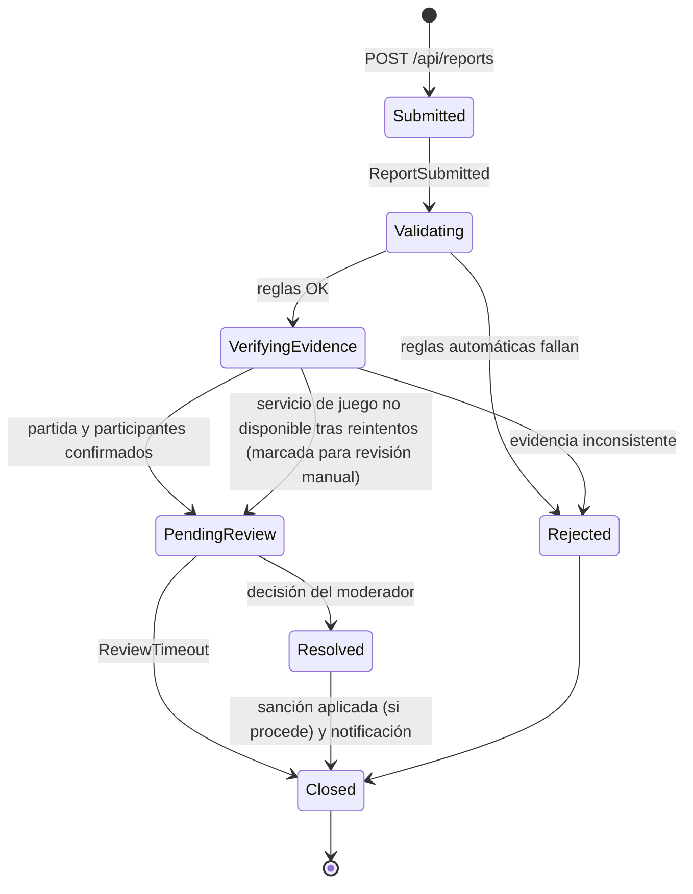

# Etapa 2: Alcance Funcional

Complementa `08-etapa-2-rotacion-de-equipos.md`. La etapa 2 tiene cuatro frentes, en este orden de prioridad:

1. **Completar lo pendiente de la etapa 1** (deuda).
2. **Leaderboard** por juego y leaderboard general en el Shell.
3. **Denuncia de usuarios** (reportes) con verificación en varias etapas usando **Wolverine**.
4. **Contenerización** de cada aplicación con **Docker**.

> **Nota sobre el estado de este documento.** Los contratos de las secciones 2, 3 y 4 son **propuestas**. Siguiendo `03-contratos-tecnicos.md`, se vuelven oficiales cuando el Tech Lead aprueba los ADRs indicados en la sección 5 y se incorporan a `03-contratos-tecnicos.md`. Todas las fechas van en UTC (ISO-8601 con sufijo `Z`).

## 1. Completar lo pendiente de la etapa 1

El equipo entrante revisa el `/docs/traspaso.md` (ver `09-plantilla-traspaso.md`) y trabaja la deuda **antes** de las features nuevas. La lista siguiente sale de los ADRs y documentos de la etapa 1. Cada equipo saliente la confirma y la completa en su traspaso.

| Repo | Deuda conocida |
|---|---|
| Todos | `.gitignore`, README con instrucciones locales, protección de `main`, CI con build + pruebas unitarias + pruebas de integración (`01` y `05`). |
| `battlehub-profile-service` | Pruebas de integración contra MySQL efímero (Testcontainers o servicio en GitHub Actions) para `POST /profiles/sync` → `GET /profiles/me`; hoy usan el proveedor en memoria (ADR-006). Clientes M2M y scope `matches.finish` en Auth0, si ADR-004 se acepta. |
| `battlehub-matchmaking` | Implementar lo decidido en ADR-004: `BackgroundService` de limpieza, máquina de estados, heartbeat validado por identidad, `POST /matches/{id}/finish` con M2M. Validar tokens y consultar permisos en Profile según ADR-007. |
| `battlehub-shell` | Carga de remotes con reintentos y pantallas de error (ADR-003), sesión única por usuario, `remotes.config.json` por ambiente. Configuración de Auth0 y audiencia según ADR-007. |
| `battlehub-game-*` | Hub propio, API de resultados (`/results`, `/history`, `/stats`), pruebas de integración de `04-persistencia-y-api-juegos.md`, `GameModule` completo (`initialize`/`start`/`pause`/`dispose`) y `finish` hacia Matchmaking. En Trivia, el script independiente de carga del banco de preguntas. |
| `battlehub-contracts` | Resolver los ADRs en estado Propuesto y reflejar los aceptados en `03-contratos-tecnicos.md`; actualizar la versión de Node de `05-cicd-testing-commits.md` (20 → 24, ADR-003). |

**Regla:** un PR de deuda se puede entregar junto con una feature nueva, pero ninguna feature de este documento se da por terminada si la deuda de su propio repo sigue abierta.

## 2. Leaderboard

### 2.1 Qué se construye

- **Cada juego** (Typing, Trivia, Memory) expone el leaderboard de su juego, calculado a partir de los resultados que ya persiste (`04-persistencia-y-api-juegos.md`), y lo muestra dentro de su microfrontend.
- **El Shell** muestra un **leaderboard general** que combina los leaderboards de los tres juegos.

### 2.2 Contrato propuesto: endpoint por juego

```http
GET /api/games/{game}/leaderboard?period=all&limit=50
```

| Parámetro | Valores | Por defecto |
|---|---|---|
| `period` | `all`, `weekly` | `all` |
| `limit` | 1 a 100 | `50` |

Respuesta:

```json
{
  "gameType": "trivia",
  "period": "all",
  "generatedAt": "2026-11-02T20:00:00Z",
  "entries": [
    {
      "rank": 1,
      "userId": "user-001",
      "displayName": "Francisco",
      "gamesPlayed": 12,
      "wins": 7,
      "bestScore": 980,
      "rankingPoints": 33
    }
  ]
}
```

Endpoint opcional recomendado: `GET /api/games/{game}/leaderboard/me`, que devuelve la posición del usuario autenticado aunque no esté en el top.

### 2.3 Puntos de ranking comparables (`rankingPoints`)

Los puntajes de cada juego no son comparables entre sí (WPM, aciertos, intentos). Para poder sumar entre juegos, todos calculan `rankingPoints` con la **misma fórmula**:

| Resultado de la partida | Puntos |
|---|---|
| Jugar una partida completa | 1 |
| Ganar la partida (`winnerUserId`) | 3 (en total, incluye el punto por jugar) |

Por ejemplo, 12 partidas jugadas con 7 victorias dan `5 × 1 + 7 × 3 = 26` puntos. Esta fórmula es una propuesta inicial y se fija en un ADR (sección 5). El orden se define por `rankingPoints` descendente y, si hay empate, por `wins` y luego por `bestScore`.

El `bestScore` queda como dato propio de cada juego y no entra en el ranking general.

### 2.4 Leaderboard general en el Shell

Opción propuesta: **el Shell consulta los tres endpoints en paralelo y suma `rankingPoints` por `userId`**.

- El `userId` es el mismo en los tres juegos (identificador del usuario autenticado, ver ADR-007).
- Si un juego no responde, el Shell muestra el ranking con los juegos disponibles e indica cuál falló. No bloquea la pantalla.
- El Shell necesita conocer la URL base de la API de cada juego. Se propone ampliar `remotes.config.json` (ADR-003) con un campo `apiBaseUrl` por juego, para no compilar URLs en el código:

```json
{
  "trivia": {
    "scope": "triviaGame",
    "url": "http://localhost:4002/remoteEntry.js",
    "module": "./GameModule",
    "apiBaseUrl": "http://localhost:5002"
  }
}
```

- Cada API de juego debe habilitar **CORS** para el origen del Shell (patrón de ADR-006: lista explícita en configuración).
- El endpoint de leaderboard puede ser público para usuarios autenticados; no se requiere permiso especial más allá de un token válido.

Alternativa a evaluar con ADR: un servicio agregador que consolide los resultados. Se descarta por defecto para no agregar un servicio nuevo, pero es una opción si el rendimiento o la consistencia lo exigen.

### 2.5 Reglas y consideraciones

- El leaderboard solo muestra `displayName`, nunca correos ni datos personales.
- Si el usuario fue sancionado por una denuncia (sección 3), la política de visibilidad en el leaderboard queda como decisión de producto del Tech Lead. Se documenta en el ADR del leaderboard.
- Las consultas deben tener índices adecuados (por `userId`, por `finishedAt` si se usa `weekly`). Un leaderboard con muchos resultados debe responder en un tiempo razonable.
- La columna `metadata` de cada resultado no se usa para el ranking.

### 2.6 Pruebas mínimas

- Integración (API del juego): guardar varios resultados con `POST /results` y verificar `GET /leaderboard` (orden, empates, `limit`, `period`).
- Unitarias: cálculo de `rankingPoints` y desempates.
- Shell: prueba de la agregación con un juego caído (resultado parcial).

## 3. Denuncia de usuarios (reportes) con Wolverine

### 3.1 Qué se construye

Un usuario puede **denunciar a otro jugador** por una conducta ocurrida en una partida. La denuncia pasa por **varias etapas de verificación** coordinadas con **Wolverine** (framework de mensajería y procesamiento de comandos para .NET), hasta que se resuelve y, si corresponde, se aplica una sanción.

### 3.2 Dónde vive

Propuesta: la funcionalidad vive en **`battlehub-profile-service`** (Equipo 6 en la etapa 2), porque ya administra usuarios, permisos y claims. Una sanción se aplica quitando permisos del usuario (por ejemplo `matches.create` o `games.*.play`), y Matchmaking ya consulta esos permisos en Profile (ADR-007).

La alternativa es un servicio nuevo de moderación. Se descarta por defecto porque agrega un repositorio y un despliegue que no encajan con el modelo de rotación, pero se puede proponer por ADR.

> **Verificación previa obligatoria (ADR).** Wolverine usa la base de datos del servicio para su bandeja de salida/entrada duradera (outbox/inbox) y para persistir sagas. Según las notas de versión recientes del proyecto, hay soporte para SQL Server, PostgreSQL, SQLite, MySQL y Oracle, pero **el equipo debe confirmar en la documentación oficial de la versión que use** el soporte para MySQL (motor de Profile), la compatibilidad con .NET 10 y el paquete de persistencia correspondiente, y dejarlo documentado en el ADR. Si MySQL no cumple, se evalúa un almacén soportado y se justifica por ADR.

### 3.3 Contrato REST propuesto

Base URL: `/api/reports`

| Método | Ruta | Permiso | Descripción |
|---|---|---|---|
| POST | `/api/reports` | `reports.create` | Crear una denuncia. Responde `202 Accepted` con el `reportId`. |
| GET | `/api/reports/me` | `reports.create` | Denuncias creadas por el usuario autenticado. |
| GET | `/api/reports/{reportId}` | Reportante o `reports.review` | Detalle y estado. |
| GET | `/api/reports?status=PendingReview` | `reports.review` | Cola del moderador. |
| POST | `/api/reports/{reportId}/review` | `reports.review` | Decisión del moderador. |

Solicitud de creación:

```json
{
  "reportedUserId": "user-002",
  "matchId": "match-001",
  "gameType": "trivia",
  "reason": "Cheating",
  "description": "Texto libre, máximo 500 caracteres"
}
```

`reason` es un enumerado cerrado, por ejemplo: `Cheating`, `Harassment`, `OffensiveName`, `Other`. Se agregan dos permisos nuevos a los de `03-contratos-tecnicos.md`: `reports.create` y `reports.review`.

Decisión del moderador:

```json
{ "decision": "Upheld", "notes": "Evidencia verificada" }
```

`decision` puede ser `Upheld` o `Dismissed`.

### 3.4 Etapas de verificación (saga)

Cada denuncia es una **saga de Wolverine** cuyo identificador es el `reportId`. Cada etapa es un mensaje con su manejador, y los mensajes se envían con el outbox para que no se pierda ninguno si el servicio se reinicia.



| Etapa | Qué hace | Si falla |
|---|---|---|
| 1. Recepción | Valida el formato, persiste la denuncia con estado `Submitted` y publica `ReportSubmitted`. | Responde `400` o `403`. No se crea la saga. |
| 2. Validación automática | Reglas: no denunciarse a sí mismo; el denunciado existe; no hay denuncia duplicada (mismo reportante, denunciado y `matchId`); límite de denuncias por usuario por día. | Estado `Rejected`, con el motivo. |
| 3. Verificación de evidencia | Consulta `GET /api/games/{game}/results/{matchId}` (ya existe en `04-persistencia-y-api-juegos.md`) y comprueba que **reportante y denunciado participaron** en esa partida y que ocurrió dentro de la ventana permitida (`[definir días]`). | Si el juego no responde: reintentos con espera creciente de Wolverine. Si se agotan, pasa a revisión manual y queda anotado. Si la evidencia es inconsistente: `Rejected`. |
| 4. Revisión del moderador | Queda en la cola `PendingReview`. Un usuario con `reports.review` decide `Upheld` o `Dismissed`. | Un mensaje programado (`ReviewTimeout`) cierra o escala la denuncia pasado `[definir plazo]`. |
| 5. Resolución y sanción | `Upheld`: se aplica una sanción en Profile (ver 3.5). `Dismissed`: sin sanción. En ambos casos se registra la decisión. | La sanción es idempotente; un reintento no la duplica. |
| 6. Notificación y cierre | Se notifica al reportante el resultado (sin revelar detalles de la sanción al reportante) y la saga se marca `Closed`. | Reintento; el cierre no depende de la notificación. |

Estados de la denuncia expuestos por la API: `Submitted`, `Validating`, `VerifyingEvidence`, `PendingReview`, `Resolved`, `Rejected`, `Closed`. Si está `Resolved`, el campo `resolution` es `Upheld` o `Dismissed`.

### 3.5 Sanciones

Propuesta inicial, a confirmar por el Tech Lead:

| Situación | Sanción |
|---|---|
| Primera denuncia confirmada | Advertencia registrada en el perfil. |
| Segunda | Suspensión temporal: se retiran permisos (`matches.create`, `games.*.play`) por `[definir duración]`. |
| Reincidencia | Suspensión mayor o indefinida, a decisión del moderador. |

El fin de una suspensión temporal se programa con **mensajes programados (scheduled messages) de Wolverine**, que sobreviven a reinicios porque quedan en la base de datos. Como Matchmaking ya consulta los permisos en Profile, la sanción se aplica sin cambiar contratos de Matchmaking.

### 3.6 Qué debe demostrar el uso de Wolverine

El objetivo académico es usar las capacidades reales del framework, no solo un mediador en memoria:

- **Manejadores (handlers)** por etapa, con mensajes bien definidos (comandos y eventos).
- **Saga** con estado persistido por denuncia.
- **Outbox/inbox duradero** en la base del servicio.
- **Política de reintentos** para llamadas a otros servicios (el servicio de juego).
- **Mensajes programados** para los timeouts y el fin de las suspensiones.
- **Idempotencia**: procesar dos veces el mismo mensaje no duplica sanciones ni notificaciones.
- **Pruebas** de los manejadores y de la saga completa, usando las herramientas de prueba del framework.

La mensajería entre etapas puede ser local (colas internas duraderas) al estar todo dentro de un mismo servicio. Usar un broker externo (por ejemplo RabbitMQ) es opcional y se documenta en un ADR; si se usa, debe poder levantarse con Docker Compose (sección 4).

### 3.7 Flujo de uso en la interfaz

- El Shell (Equipo 2) agrega el botón **"Denunciar"** en los resultados de partida y el panel de moderación para usuarios con `reports.review`.
- Los juegos no llaman a `/api/reports` ni manejan permisos (`03-contratos-tecnicos.md` §7). Si un juego muestra su lista de jugadores y quiere ofrecer "Denunciar", dispara un evento del navegador para que el Shell abra el diálogo:

```javascript
window.dispatchEvent(new CustomEvent('battlehub:report-user', {
  detail: { reportedUserId: 'user-002', matchId: 'match-001', gameType: 'trivia' }
}));
```

Este evento es una **extensión del contrato visual** y requiere ADR.

### 3.8 Seguridad y privacidad

- La denuncia contiene datos sensibles: solo la ven el reportante, el moderador y el sistema. **El denunciado nunca ve quién lo denunció.**
- El texto libre se valida y se limita en longitud. Se escapa al mostrarse.
- No se guardan tokens en la base ni en los logs.
- Un usuario sancionado no puede usar la denuncia para represalias: se mantiene el límite diario de denuncias.
- Toda decisión de moderador queda registrada (quién, cuándo en UTC, qué).

### 3.9 Pruebas mínimas

- Unitarias: reglas de validación automática, cálculo de sanción, transiciones de la saga.
- Integración (con la base real del servicio): crear denuncia → pasar por todas las etapas → decisión del moderador → sanción aplicada y reflejada en `GET /api/profiles/me/permissions`.
- Integración: servicio de juego no disponible → reintentos → revisión manual.
- Integración: mensaje duplicado → sin sanción duplicada.

## 4. Contenerización con Docker

Cada equipo contenieriza **el servicio de su repo heredado**, y verifica que pueda levantarse con un solo comando.

### 4.1 Entregables por repositorio

| Archivo | Contenido |
|---|---|
| `Dockerfile` | Construcción en varias etapas (multi-stage): una para compilar, otra mínima para ejecutar. En repos con frontend y API, un Dockerfile por componente (por ejemplo `api/Dockerfile` y `web/Dockerfile`). |
| `.dockerignore` | Excluye `bin/`, `obj/`, `node_modules/`, `.git`, `.env*`, `TestResults/` (alineado con `gitignore-template.txt`). |
| `docker-compose.yml` | Levanta el servicio **y sus dependencias** (base de datos, y broker si aplica) para desarrollo local. |
| `.env.example` | Variables necesarias, sin valores secretos. |
| README | Sección "Ejecutar con Docker" con los comandos y los puertos. |

### 4.2 Reglas obligatorias

- **Sin secretos en la imagen ni en el repo.** Todo se configura por variables de entorno (dominio y audience de Auth0, cadenas de conexión, orígenes CORS, como en ADR-006).
- La imagen se ejecuta con un **usuario no root**.
- Las imágenes base usan **versiones fijas** (sin `latest`). Backend: imágenes oficiales de .NET 10. Frontend: Node 24 para compilar (ADR-003) y un servidor web liviano para servir los archivos estáticos.
- Cada API expone `GET /health` (o el endpoint estándar de health checks de ASP.NET Core), y el compose define un `healthcheck` y `depends_on` con condición de salud para la base de datos.
- Los datos de la base usan un **volumen**; `docker compose down -v` debe dejar todo limpio.
- Los puertos locales se mantienen: Shell `4000`; Typing, Trivia y Memory `4001`, `4002` y `4003` (ADR-003). Las APIs usan los puertos que documente cada equipo en su README. Se propone una convención para evitar choques: **`5000 + n`** para el equipo `n` de juego (`5001`, `5002`, `5003`), y el puerto de Profile y Matchmaking según sus README.
- Frontend: los remotes deben servir `remoteEntry.js` con **CORS habilitado** (ADR-003 §8). El `remotes.config.json` del Shell debe poder **reemplazarse sin recompilar**: se monta como volumen o se genera al arrancar el contenedor.
- La migración de base de datos y la carga de datos iniciales (por ejemplo el banco de preguntas de Trivia) se ejecutan de forma controlada y documentada, no escondidas en el arranque sin posibilidad de repetirlas.

### 4.3 Integración con CI

El paso 6 de `05-cicd-testing-commits.md` (publicación de artefacto o imagen, que era opcional en la etapa 1) cambia así:

| Paso | Etapa 1 | Etapa 2 |
|---|---|---|
| Construir imagen Docker | Opcional | **Obligatorio** en cada PR hacia `main` (`docker build`, sin publicar). |
| Publicar la imagen en un registro | Opcional | Opcional. Si se hace, solo en `push` a `main`, con etiquetas por commit o versión, nunca `latest` como única etiqueta. |

Ejemplo de job adicional:

```yaml
  docker-build:
    runs-on: ubuntu-latest
    needs: build-and-test
    steps:
      - uses: actions/checkout@v4
      - name: Build Docker image
        run: docker build -t battlehub-<servicio>:ci .
```

Como el CI de PRs desde forks no tiene secretos (`08-etapa-2-rotacion-de-equipos.md` §3), la construcción de la imagen no puede depender de ellos.

### 4.4 Orquestación de toda la plataforma (propuesta)

Para probar la integración completa, el Tech Lead puede mantener en `battlehub-contracts` una carpeta `/deploy` con un `docker-compose.platform.yml` que levante todas las imágenes. Cada equipo aporta por PR la definición de su servicio (imagen, puertos, variables). Esto está **pendiente de aprobación** y se documenta con un ADR. Auth0 sigue siendo un servicio externo (el tenant compartido); no se levanta en Docker.

## 5. ADRs requeridos en esta etapa

Los ADRs continúan la numeración consecutiva después del último existente (se muestran con `ADR-NNN`; el Tech Lead asigna los números). Se guardan en `/adrs` de `battlehub-contracts`.

| ADR | Tema | Equipo que lo propone (etapa 2) | Afecta a |
|---|---|---|---|
| ADR-NNN | Contrato de leaderboard por juego y fórmula de `rankingPoints` | Equipos 3, 4 y 5 (juegos), con el Equipo 2 (Shell) | Contratos `03` y `04` |
| ADR-NNN | `apiBaseUrl` en `remotes.config.json` y CORS de las APIs de juego hacia el Shell | Equipo 2 | ADR-003, APIs de juego |
| ADR-NNN | Módulo de denuncias: ubicación (Profile), verificación de Wolverine con MySQL, estados, sanciones | Equipo 6 | Contratos `03`, Profile |
| ADR-NNN | Evento del navegador `battlehub:report-user` | Equipo 2 con los equipos de juego | Contrato visual |
| ADR-NNN | Convenciones de Docker (puertos, health checks, variables, `/deploy`) | Equipo 1 o el que designe el Tech Lead | `05`, todos los repos |
| ADRs de cambio de motor, si alguien lo cambia | Solo si procede (`08` §7) | Quien lo proponga | El servicio afectado |

Cada ADR debe incluir alternativas consideradas y consecuencias, siguiendo `06-adr-template.md`. Los que modifican un contrato se abren como PR a `battlehub-contracts` y los aprueba el Tech Lead **antes** de implementarse.

## 6. Reparto por equipo

| Equipo | Repo heredado | Deuda de etapa 1 | Feature nueva | Docker |
|---|---|---|---|---|
| Equipo 1 | `battlehub-matchmaking` | ADR-004 (limpieza, estados, heartbeat, `finish`), ADR-007 (token y permisos) | Verificar que las sanciones (permisos retirados) bloquean crear y unirse a partidas. Coordinar la convención de Docker de la sección 4. | Matchmaking + MongoDB |
| Equipo 2 | `battlehub-shell` | ADR-003 completo, sesión única, Auth0 con audiencia acordada | **Leaderboard general**, botón "Denunciar" y panel de moderación | Shell (estático) |
| Equipo 3 | `battlehub-game-typing` | Hub, API de resultados, pruebas de integración, `GameModule` completo | **Leaderboard de Typing** (API + microfrontend) | API + microfrontend + MySQL |
| Equipo 4 | `battlehub-game-trivia` | Ídem; script de banco de preguntas | **Leaderboard de Trivia** (API + microfrontend) | API + microfrontend + SQL Server |
| Equipo 5 | `battlehub-game-memory` | Ídem | **Leaderboard de Memory** (API + microfrontend) | API + microfrontend + SQL Server |
| Equipo 6 | `battlehub-profile-service` | Pruebas contra MySQL, clientes M2M, tenant de Auth0 (ver `08` §6) | **Denuncias con Wolverine** (backend completo) | Profile + MySQL (+ broker si se usa) |

## 7. Criterios de aceptación de la etapa

**Deuda de la etapa 1**
- [ ] Todos los repos cumplen `01` y `05`: `.gitignore`, README, protección de `main`, CI en verde.
- [ ] Los ADRs de la etapa 1 están resueltos y los contratos aceptados están en `03-contratos-tecnicos.md`.

**Leaderboard**
- [ ] Cada juego responde `GET /api/games/{game}/leaderboard` con el contrato acordado y muestra el ranking en su microfrontend.
- [ ] El Shell muestra el leaderboard general sumando los tres juegos y tolera que un juego no responda.
- [ ] Pruebas unitarias y de integración del cálculo en cada juego.

**Denuncias**
- [ ] Un usuario puede denunciar a otro desde el Shell.
- [ ] La denuncia pasa por validación automática, verificación de evidencia y revisión del moderador, coordinadas con Wolverine (saga, outbox duradero, reintentos, mensajes programados).
- [ ] Una denuncia confirmada aplica una sanción visible en los permisos del usuario y se levanta cuando vence.
- [ ] Reproceso de un mensaje duplicado no duplica sanciones.
- [ ] Pruebas de integración de todo el flujo corren en CI.

**Docker**
- [ ] `docker compose up` levanta el servicio y sus dependencias desde cero, siguiendo solo el README.
- [ ] La imagen corre sin secretos, con usuario no root y versiones fijas.
- [ ] El job `docker build` está en el CI y pasa.

**Proceso**
- [ ] Todos los cambios entraron por fork + PR, con aprobación del equipo saliente.
- [ ] Cada cambio de contrato tiene un ADR aprobado.
- [ ] `/docs/traspaso.md` actualizado al cierre.
